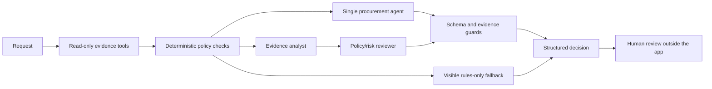

# AI Procurement Request Copilot

Tirth

A local procurement review app that gathers business evidence, checks policy in
code, and uses Groq's `openai/gpt-oss-120b` to interpret a purchase request. It
recommends the next step and prepares a human review package. It cannot approve
spend, purchase software, change budgets, or accept legal terms.

All business records in the starter pack are synthetic. Access labels describe
proposed use; the repository contains no customer records, source code from a
customer, production credentials, or confidential customer documents.

## Setup and start

Tested on Windows with Python 3.12. Use Python 3.12 for the locked environment.

```powershell
python -m venv .venv
.\.venv\Scripts\python.exe -m pip install -r requirements-lock.txt
if (-not (Test-Path .env)) { Copy-Item .env.example .env }
```

On macOS/Linux, use `.venv/bin/python` in place of `.\.venv\Scripts\python.exe`.
Use `cp -n .env.example .env` to create the local configuration there.
Do not overwrite an existing `.env` containing your key.

Add your Groq Console key to the ignored `.env` file:

```dotenv
VENDOR_RISK_BASE_URL=http://127.0.0.1:8001
COPILOT_MODE=auto
MODEL_PROVIDER=groq
MODEL_NAME=openai/gpt-oss-120b
GROQ_API_KEY=your_key_here
```

Only the selected provider's key is required. Provider HTTPS calls use `requests`;
there is no undeclared SDK dependency. Environment variables take precedence over
`.env`. Restart the app after changing provider settings.

Start both local services with one command:

```powershell
.\.venv\Scripts\python.exe run_local.py
```

Open [the app](http://127.0.0.1:8501). The mock vendor API is at
[127.0.0.1:8001](http://127.0.0.1:8001/docs). Both bind to loopback. Ctrl+C stops
both child processes. If a port is occupied, stop the earlier instance first.

The lock file records the environment used for verification. `requirements.txt`
contains the direct dependency ranges. `verify_setup.py` checks imports, datasets,
the output contract and the mock API without using an LLM key.

## Using the product

1. Choose a sample request or complete the custom request form.
2. Select A (single agent) or B (analyst + reviewer).
3. Select an execution mode and analyze the request.
4. Inspect the recommendation, evidence, required reviewers, risks and gaps.
5. Download the JSON review package and handoff note. Obtain approvals outside
   the app before any purchase.

`auto` uses the configured model and shows a warning if it must fall back to
rules. `live` requires successful model reasoning; it reports failure instead of
presenting an offline result as an agent run. `offline` runs deterministic checks
only. The UI clears old results whenever the request, mode or architecture changes.
Blank cost or user counts stay unknown. An empty integration list explicitly
means none. Amounts must be annual totals in USD.

[Verified UI example](docs/ui-review.jpg)

## Workflow and architecture





A uses one reasoning stage. B adds an analyst-to-reviewer handoff and a second
model call against the same original evidence. This is a staged workflow, not
open-ended delegation. Mandatory evidence retrieval is orchestrated in code so
the model cannot skip a source. The models interpret fit and context; code owns
thresholds, dates, budget arithmetic and minimum review requirements.

| Tool | Source and responsibility |
|---|---|
| `requester_budget` | Employee department and available department budget |
| `catalog` | Approved products, scope and candidate overlap |
| `registry` | Internal vendor security, procurement and terms status |
| `history` | Prior agreements, without treating history as approval |
| `vendor_risk` | Real HTTP retrieval from the local mock assessment service |
| `policy` | Policy text, reference date and content digest |
| `policy_rules` | Deterministic approvals, dates, budgets and review controls |

All seven tools are read-only and deterministic. Model calls are counted
separately. `EvidencePack`, `ToolResult` and `Advisory` define the internal
boundaries. `handle_request(request_id, architecture)` retains the starter
adapter and returns `ProcurementDecision`. Custom inputs use `analyze_request`.
See [workflow notes](docs/workflow.md) for the handoff format, assumptions and
failure boundaries; [diagram source](docs/architecture.mmd) is editable Mermaid.

## Reliability and human controls

- Money uses Decimal. Financial approval thresholds are tested on both sides of
  $1,000, $10,000 and $25,000.
- Review ages use **2026-09-30**, extracted from policy 2026.09. A review is
  current through day 365. Future, malformed or missing dates need review.
- Internal/external disagreement is surfaced; one source never silently wins.
- PII, sensitive scope, production/source-code access and overseas storage route
  to the applicable specialists. Prior vendor approval does not waive controls.
- Missing inputs and failed data sources stay visible. Vendor API failure never
  falls back to reading `data/vendor_risk.json` inside the copilot.
- Catalog overlap is a question for Procurement, not automatic rejection. Total
  licensed seats are not spare capacity. Claimed product gaps need validation.
- Request and vendor text are untrusted. Injection detection is a warning
  heuristic. Authority is protected by read-only tools and mandatory rules.
- Model interpretation stays separate from source evidence. References and IDs
  are validated; a valid citation does not prove every generated sentence.
- Content guards reject asserted spare capacity, missing integrations described
  as none, and an incorrect stated budget shortfall. These are targeted checks,
  not a complete factuality classifier.
- Provider errors are sanitized. Hosted prompts exclude employee identity and
  reporting records. Keys are never passed into prompts or displayed.

## Re-run verification and evaluation

Run all non-billable checks, including tests and the architecture comparison:

```powershell
.\.venv\Scripts\python.exe scripts/verify_all.py
```

Individual commands:

```powershell
.\.venv\Scripts\python.exe verify_setup.py
.\.venv\Scripts\python.exe -m unittest discover -s tests -v
.\.venv\Scripts\python.exe evals/compare.py --mode offline --repeat 3
.\.venv\Scripts\python.exe evals/replay_guards.py
.\.venv\Scripts\python.exe scripts/check_secrets.py
```

The comparison starts the mock API when needed and stops only its own process.
It runs six public cases and ten additional cases on both paths, including new
request IDs, amount boundaries, missing integrations, PII, stale/conflicting
reviews, existing tools, injection and unknown vendors/requesters.

Run the actual model comparison separately; this uses your Groq quota:

```powershell
.\.venv\Scripts\python.exe evals/compare.py --mode live --pause 10 --output-dir evals/results/live_rerun
```

Groq rate limits can dominate latency. A provider HTTP 429 or schema-generation
failure permits at most two bounded retries; each HTTP attempt is counted.
An explicit daily-quota error is not retried. The comparison stops and marks
the report partial; unattempted cases are not counted as completed.
The CSV includes failures rather than treating failed runs as success.
Reports are written to `evals/results/offline` and `evals/results/live` with
per-case decisions, latency, tool/LLM counts and a summary. A run replaces its
mode's previous report. Use a new `--output-dir` to retain earlier experiments.
Progress is saved after each attempt, including failures.

The original public harness still works while the mock API is running:

```powershell
.\.venv\Scripts\python.exe evals/run_public_evals.py --architecture single
.\.venv\Scripts\python.exe evals/run_public_evals.py --architecture staged
```

## Evaluation evidence and ship decision

Ship **A, the single-agent workflow, in auto mode** for this local MVP. It retains
the same deterministic controls while using fewer reasoning stages and exposing
fewer handoff/provider failures. The completed project has 61 automated tests.

| Measured result | Single A | Staged B |
|---|---:|---:|
| Offline cases, three repeats | 48/48 | 48/48 |
| Original live public structural checks | 6/6 | 6/6 |
| Original live full-set completions | 15/16 | 13/16 |
| Mean live latency including retries | 16.56 s | 46.63 s |
| Mean model HTTP attempts | 2.00 | 4.00 |
| Tool calls | 7 | 7 |
| Saved completed outputs accepted by final guards | 14/15 | 11/13 |

The live experiment exposed one invalid B handoff and three provider 429
failures. Manual review found three additional narrative defects, now rejected
by regression-tested content guards. The final row is a zero-model-call replay
of saved outputs, not a fresh live run after those guard changes. Raw live
results remain preserved. Provider limits and a small serial test set prevent
strong statistical conclusions.

The current-code audit attempted a fresh comparison: five checks passed before
two HTTP 429 failures, after which Groq confirmed its daily token limit was
exhausted. A subsequent run verified immediate quota detection and saved a
partial report. A complete fresh comparison remains blocked by provider quota.
See [evaluation details](docs/evaluation.md).

The committed [evaluation report](docs/evaluation.md) contains measured results,
case-level findings and limitations. The [decision memo](docs/architecture_decision.md)
is under 500 words. Raw results are committed under [evals/results](evals/results).
Offline measurements validate shared policy behavior; they are not AI-quality
measurements. Live reasoning needs separate source-grounding review.

## Repository and submission

[Requirement map](docs/requirements.md) links each assessment deliverable to the
implementation and evidence. The supplied assessment PDF is preserved at
[docs/FDE_Assessment_3.pdf](docs/FDE_Assessment_3.pdf); it includes the public
repository and Google Form requirements omitted from the bundled short brief.


## Known limitations

This is a local MVP with synthetic snapshots, not a production procurement
system. There is no login, persistent approval ledger, concurrent budget
reservation or purchasing integration. The policy rules must be reviewed when
policy changes. Category/vendor matching can overstate overlap, and model
interpretation can still be wrong. Pattern-based injection detection is not
complete. The live comparison is small and affected by provider limits; it does
not justify broad reliability claims. A production rollout needs access control,
fresh authoritative data, provider/data governance and reviewer validation.

